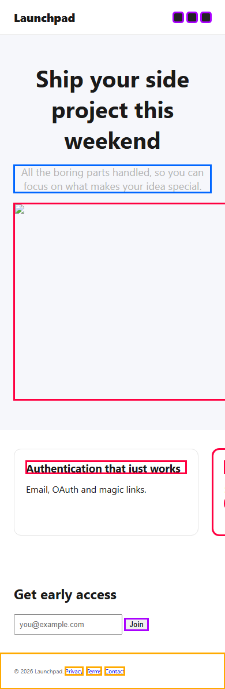
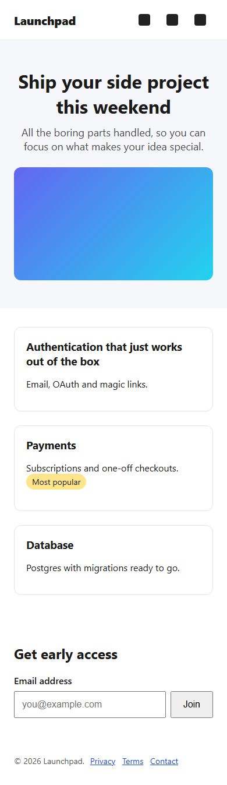

# visual-qa

**Your coding agent can't see the UI it builds. This skill gives it eyes.**

`visual-qa` renders your app in a real browser at mobile, tablet and desktop sizes. It measures layout bugs instead of guessing at them, saves screenshots with every problem outlined, and runs a fix → re-check loop until the page is clean. It also catches visual regressions against a saved baseline, so "it was working, now it's broken" gets caught before you ship.

| Before (22 issues on mobile) | After one fix loop (PASS) |
|---|---|
|  |  |

Red = layout bug · purple = tap target too small · orange = tiny text · blue = accessibility

## Why this is a skill, not a prompt

A prompt can only ask the agent to *imagine* what the page looks like. This skill ships a deterministic checker:

- **Real rendering** in headless Chromium (Playwright), with mobile emulation and touch
- **Measured, not guessed:** sideways scroll, the exact element causing it and by how many px; clipped text; tap targets under 24×24 (WCAG 2.2); text under 12px; broken images; JS exceptions; failed requests
- **Accessibility scan** with axe-core (contrast, labels, alt text, names, lang…)
- **Visual regression:** pixel diff against a known-good baseline
- **Annotated screenshots** so the agent (and you) can see where each problem is
- **Same input, same report:** a stable loop exit condition instead of "looks good to me"

## What it catches

| Check | Severity | Example |
|---|---|---|
| JS exceptions | high | `Cannot read properties of null` |
| Failed document/script/CSS requests | high | 404 on your bundle |
| Broken images | high | wrong path, missing remote domain |
| Horizontal overflow | high | page scrolls sideways on phones; names the culprit element |
| Serious/critical a11y violations | high | low contrast, unlabeled buttons, missing alt |
| Clipped text | medium | fixed heights cutting off headings |
| Small tap targets | medium | 18×18 icon buttons |
| Console errors, other failed requests | medium | 401 from an API call |
| Tiny text | low | 10px footer links |
| Changed vs baseline | info | 1.8% of pixels differ → diff image |

## Install

1. Copy the `visual-qa/` folder into your coding agent's skills directory (the folder where your agent loads `SKILL.md`-based skills, either per project or user-wide).
2. Install the script dependencies once (Node 18+):

```bash
cd visual-qa/scripts
npm ci
npx playwright install chromium
```

3. Add `.visual-qa/` to your project's `.gitignore`.

Then just build UI as usual. The skill triggers when you change pages or say things like *"check it on mobile"*, *"the layout looks broken"*, or *"QA the landing page"*.

## Use the checker directly (no agent needed)

```bash
node visual-qa/scripts/capture.mjs --url http://localhost:3000 --routes /,/pricing,/login
```

Useful flags: `--viewports mobile,1280x720`, `--save-baseline`, `--strict` (exit 1 on high-severity issues, for CI), `--json`. See [`visual-qa/SKILL.md`](visual-qa/SKILL.md) for all of them.

Output goes to `.visual-qa/latest/`: `summary.md`, `report.json`, and per-route `*.png`, `*.annotated.png` and `*.diff.png`.

### In CI (GitHub Actions)

```yaml
- run: cd visual-qa/scripts && npm ci && npx playwright install --with-deps chromium
- run: npm run build && (npm start &) && npx wait-on http://localhost:3000
- run: node visual-qa/scripts/capture.mjs --url http://localhost:3000 --routes /,/pricing --strict
- uses: actions/upload-artifact@v4
  if: always()
  with: { name: visual-qa, path: .visual-qa/latest }
```

## Try it on the demo

```bash
node visual-qa/scripts/capture.mjs --url "file://$PWD/visual-qa/examples/broken-landing/index.html"
node visual-qa/scripts/capture.mjs --url "file://$PWD/visual-qa/examples/fixed-landing/index.html"
```

The first page reports **FAIL** with 56 issues across 3 viewports, the second **PASS** with 0. (On Windows use `file:///C:/path/to/...`.)

## Security

The checker is designed to be safe to run on real projects: secrets are redacted from all output, it only deletes folders it created, only allows http/https/file URLs, keeps the browser sandbox on, and blocks downloads, permissions and service workers. Details and threat model: [SECURITY.md](SECURITY.md).

```bash
cd visual-qa/scripts && npm test    # security regression tests
```

## Repo layout

```
visual-qa/
├── SKILL.md              instructions the agent follows (run → look → fix → loop)
├── references/fixes.md   root causes + fixes per issue type (loaded on demand)
├── scripts/
│   ├── capture.mjs       the checker
│   ├── package.json      pinned via package-lock.json
│   └── test/             security tests
└── examples/             broken + fixed demo pages
```

## License

MIT
